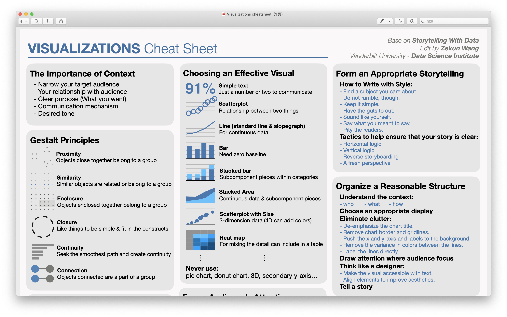

# Visualization Cheat Sheet

A quick reference for efficient data visualization

> A compact cheat sheet for choosing charts and visual encodings when exploring and presenting data.

- Canonical: https://www.zekun.blog/2019/09/13/visualization-cheatsheet/
- Published: 2019-09-13
- Author: Zekun Wang
- Tags: Visualization, Cheat Sheet, Keynote

Created by **Zekun Wang**

Based on **Storytelling With Data**

Download: [PDF version](/downloads/visualizations-cheatsheet.pdf)

## Related

- [COVID-19 Data Exploration (WIP)](https://www.zekun.blog/2020/03/19/COVID-19-EDA/index.md): Early exploratory analysis and visualization of COVID-19 data while the pandemic was still unfolding.
- [LAPOP Data Dashboard](https://www.zekun.blog/2020/02/19/LAPOP-dashboard/index.md): A Shiny dashboard prototype for exploring LAPOP survey data with interactive filters and charts.

Older: [If home-field advantage exists, how much of an impact does it have on winning the World Series?](https://www.zekun.blog/2019/09/12/home-advantage/index.md)
Newer: [Which quantiles of a continuous distribution can one estimate with more precision?](https://www.zekun.blog/2019/09/18/quantile-precision/index.md)
