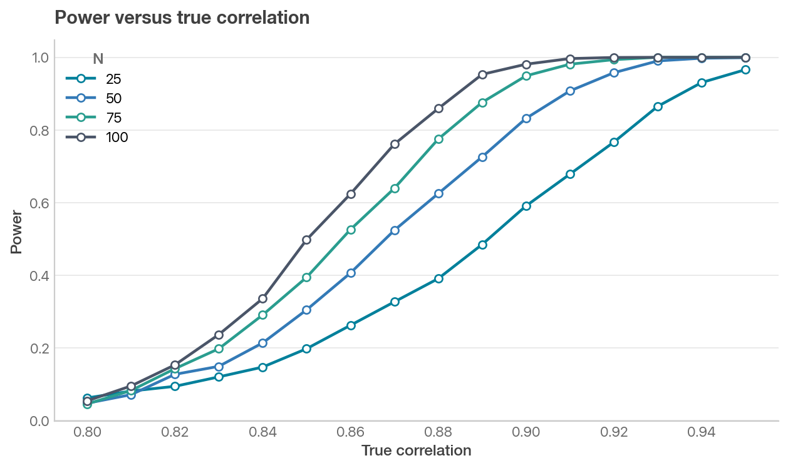

# Power and Sample Size Calculations for Correlational Studies

Probability and Statistical Inference - 10

> Walk through power and sample-size calculations for correlational studies with simulation checks.

- Canonical: https://www.zekun.blog/2019/11/22/power-correlation/
- Published: 2019-11-22
- Author: Zekun Wang
- Tags: Statistics, Simulation, R
- Series: Probability and Statistical Inference, part 9 of 9

A common research objective is to demonstrate that two measurements are highly correlated. One measurement, call it A, may reflect the severity of disease but is difficult or costly to collect. Another measurement, call it B, may be easier to collect and potentially related to measurement A. If there is a strong association between A and B, a cost-effective strategy for diagnosis may be to collect measurement B instead of A.

The researcher will collect both measurements on $N$ individuals. Pairs are modeled as bivariate normal with correlation $\rho$:

$$
\begin{pmatrix} A \\ B \end{pmatrix}
\sim
\mathcal{N}\!\left(
\begin{pmatrix} 0 \\ 0 \end{pmatrix},
\begin{pmatrix}
1 & \rho \\
\rho & 1
\end{pmatrix}
\right).
$$

The analysis will proceed by calculating a one-sided confidence interval for the correlation (`cor.test(..., alternative = "greater")`). That interval has the form $[\ell_{1-\alpha}(\hat\rho),\,1]$ (up to the usual correlation bound), so requiring the interval to lie inside $[0.8,1]$ is equivalent to requiring the lower endpoint alone to exceed $0.8$:

$$
\text{Success} \iff \ell_{1-\alpha}(\hat\rho) > 0.8.
$$

Power is the probability that the study will end in success when the true underlying correlation has a given value:

$$
\mathrm{Power}(N,\rho)
=
P\bigl(\ell_{1-\alpha}(\hat\rho) > 0.8 \mid \rho\bigr).
$$

(This post estimates power by Monte Carlo under the bivariate-normal model above, rather than a closed-form Fisher-$z$ calculation.)

The code below provides the power calculation for a single combination of $N$ and population correlation.

```r
set.seed(1122)
suppressPackageStartupMessages(require(mvtnorm))
N <- 50
rho <- .95
null_correlation <- 0.8
R <- 5000

sigma <- array(c(1,rho,rho,1), c(2,2))
mu <- c(0,0)

detect <- rep(NA, R)
for(i in 1:R){
  data <- rmvnorm(N, mean = mu, sigma = sigma)
  results <- cor.test(x = data[,1], y = data[,2], alternative = "greater")
  detect[i] <- results$conf.int[1] > null_correlation
}
power <- mean(detect)
```

For the simulation part, we need to use correlations from 0.8 to 0.95 and the sample size from 25 to 100. Now, let's create a table to save the generated powers.

```r
corr_list <-  seq(0.8,0.95,0.01)
N_list <- seq(25,100,25)
result <- expand.grid(corr=corr_list, N = N_list, power=NA)
```

Then use a for loop to apply all the correlations and sample sizes and calculate the power values.

```r
for (j in 1:nrow(result)){
  N <- result[j,2]    #50
  rho <- result[j,1]  #.8
  null_correlation <- 0.8
  R <- 5000

  sigma <- array(c(1,rho,rho,1), c(2,2))
  mu <- c(0,0)

  detect <- rep(NA, R)
  for(i in 1:R){
    data <- rmvnorm(N, mean = mu, sigma = sigma)
    results <- cor.test(x = data[,1], y = data[,2], alternative = "greater")
    detect[i] <- results$conf.int[1] > null_correlation
  }
  power <- mean(detect)
  result[j,3] <- power
}
```

Transform the table into a data frame and plot the graph.

```r
result_df <- as.data.frame(result) %>%
  mutate(N=factor(N))

result_df %>%
  ggplot()+
  geom_line(aes(x=corr,y=power,color=N),size=1)+
  theme_bw()+
  labs(x="Correlation",y="Power")
```


As we can see, as N increases, the power for a given correlation also increases. In other words, when we can collect more samples, the probability that the study will end in success is higher. When the true correlation is higher, the probability is also higher.


## Probability and Statistical Inference

- [Roulette](https://www.zekun.blog/2019/08/26/roulette-simulation/index.md)
- [Absolute vs Relative Error](https://www.zekun.blog/2019/09/06/absolute-relative-error/index.md)
- [World Series](https://www.zekun.blog/2019/09/09/world-series/index.md)
- [Home Advantage](https://www.zekun.blog/2019/09/12/home-advantage/index.md)
- [Quantile Precision](https://www.zekun.blog/2019/09/18/quantile-precision/index.md)
- [Coverage Probability](https://www.zekun.blog/2019/10/15/coverage-probability/index.md)
- [Simulation Compare](https://www.zekun.blog/2019/10/27/simulation-compare/index.md)
- [CLT](https://www.zekun.blog/2019/11/12/clt/index.md)
- Power & Correlation (this page)

## Related

- [COVID-19 Data Exploration (WIP)](https://www.zekun.blog/2020/03/19/COVID-19-EDA/index.md): Early exploratory analysis and visualization of COVID-19 data while the pandemic was still unfolding.
- [LAPOP Data Dashboard](https://www.zekun.blog/2020/02/19/LAPOP-dashboard/index.md): A Shiny dashboard prototype for exploring LAPOP survey data with interactive filters and charts.
- [Cashbox Magazine Song Chart Analysis](https://www.zekun.blog/2020/02/15/song-analysis/index.md): An end-to-end data analysis pipeline using Cashbox Magazine song chart history, from cleaning to visualization.

Older: [Central Limit Theorem - Approximation](https://www.zekun.blog/2019/11/12/clt/index.md)
Newer: [As data scientists, what should we do?](https://www.zekun.blog/2019/12/11/ds-applications/index.md)
