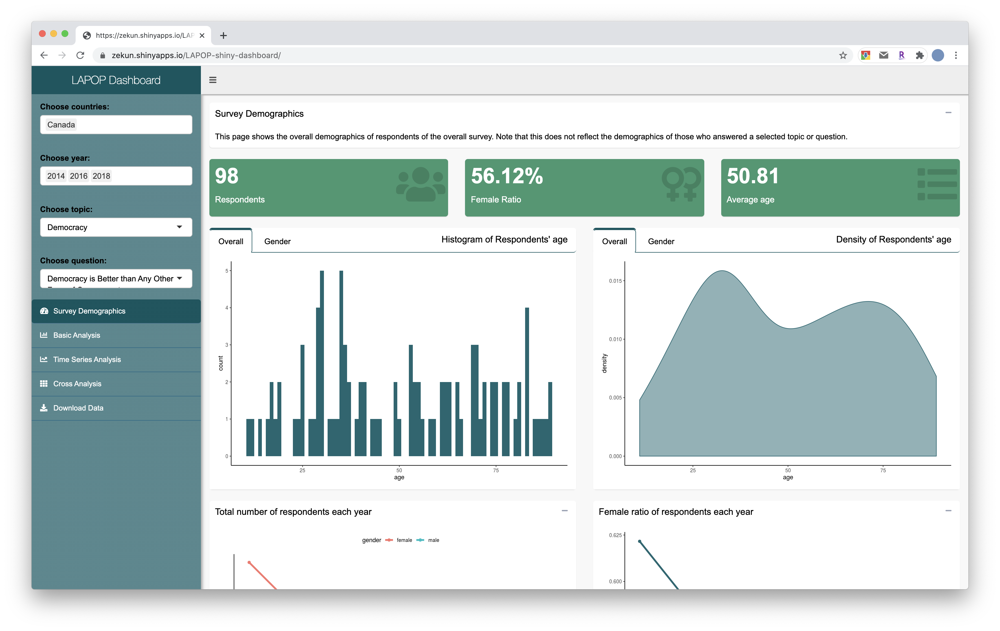

# LAPOP Data Dashboard

A dashboard prototype built with Shiny R

> A Shiny dashboard prototype for exploring LAPOP survey data with interactive filters and charts.

- Canonical: https://www.zekun.blog/2020/02/19/LAPOP-dashboard/
- Published: 2020-02-19
- Author: Zekun Wang
- Tags: Dashboard, Visualization, Project, R, Web Application

This project is a data visualization dashboard designed to help non-professional users explore the Latin American Public Opinion Project (LAPOP).

Due to copyright issues and confidentiality agreements, the dashboard is shown with randomly generated data based on the real data format.

**How to use it?**

1. Select the countries and years you want to analyze (multiple choices) to obtain key figures and visualizations of the overall situation of the respondents.
2. Select the topics and questions you want to analyze in detail, and obtain key figures, visualization results, and time-series visualizations for a single question.
3. Select topics and questions for cross-analysis to get visual results for cross-analysis.

**[Click here to open the dashboard](https://zekun.shinyapps.io/LAPOP-shiny-dashboard/)**

Project GitHub page: [LAPOP-shiny-dashboard](https://github.com/waittim/LAPOP-shiny-dashboard)

## Related

- [Slides Thief 2.0: From Rectangle Heuristics to Evidence-Aware Review](https://www.zekun.blog/2026/08/01/slides-thief-2-detection/index.md): How Slides Thief 2.0 combines multiple detectors, candidate scoring, local refinement, and batch geometry for more reliable browser-local correction.
- [Slides Thief - Turn Photographed Presentation Slides into Clean PDFs](https://www.zekun.blog/2026/07/13/slides-thief/index.md): Slides Thief is a browser-based tool that turns photographed presentation slides into perspective-corrected images and clean PDFs, with all processing performed locally.
- [Super-Fast In-Browser Face Mask Detection](https://www.zekun.blog/2020/11/27/mask-detection/index.md): WearMask: a super-fast in-browser face mask detector that runs locally with NCNN and WebAssembly.

Older: [Cashbox Magazine Song Chart Analysis](https://www.zekun.blog/2020/02/15/song-analysis/index.md)
Newer: [COVID-19 Data Exploration (WIP)](https://www.zekun.blog/2020/03/19/COVID-19-EDA/index.md)
