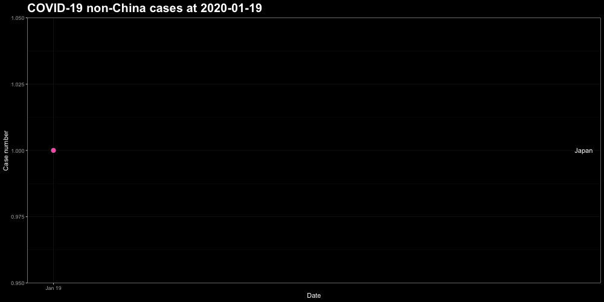

# COVID-19 Data Exploration (WIP)

Exploration and visualization of COVID-19-related data

> Early exploratory analysis and visualization of COVID-19 data while the pandemic was still unfolding.

- Canonical: https://www.zekun.blog/2020/03/19/COVID-19-EDA/
- Published: 2020-03-19
- Author: Zekun Wang
- Tags: COVID-19, Visualization, EDA, R

**Note:** The content of this article is based on data collected by the project team of Professor [Ziqi Chen](http://faculty.csu.edu.cn/chenziqi/en/index.htm), [School of Mathematics and Statistics, Central South University](https://en.csu.edu.cn/Schools/schools2/Mathematics_and_Statistics.htm) (China). The data used for this analysis are not complete.

# 10-import

Load the necessary packages.

```r
library(tidyverse)
library(ggplot2)
library(gganimate)
library(plotly)
library(readxl)
library(lubridate)
library(gifski)
```
Read data from Excel.

```r
abroad_raw <- read_excel("data/【海外】疫情数据.xlsx")
```

Convert wide tables to long tables and process date data into a usable form.

```r
data <- abroad_raw %>%
  select(-name) %>%
  pivot_longer(
    -country,
    names_to = "date",
    values_to = "number",
    values_drop_na = TRUE
  ) %>%
  mutate(date = as.integer(date)) %>%
  mutate(date = as.Date(date, origin = "1899-12-30"))

```


# 20-exploratory-data-analysis

```r
line <- data %>%
  ggplot(aes(x = date, y = number, group = country)) +
  geom_line(aes(color = country), size = 2, alpha = 0.5) +
  geom_point(aes(color = country), size = 3) +
  geom_text(
    aes(label = country),
    #color = "black",
    check_overlap = TRUE,
    hjust = 0,
    nudge_x = 0.3
  ) +
  ggdark::dark_theme_bw() +
  theme(plot.title = element_text(face = "bold", size = 20)) +
  guides(color = FALSE) +
  labs(
    title = paste0('COVID-19 non-China cases at ', '{frame_along}'),
    y = "Case number",
    x = "Date"
  ) +
  transition_reveal(date) +
  view_follow() +
  ease_aes(default = 'linear')

```

```r
animate(
  line,
  width = 1000,
  height = 500,
  renderer = gifski_renderer(),
  duration = 20,
  rewind = FALSE,
  end_pause = 1
)
anim_save("output.gif")
```




Project GitHub page: [COVID-19-EDA](https://github.com/waittim/COVID-19-EDA)


## Related

- [Social inequality and cultural factors impact the awareness and reaction during the cryptic transmission period of the pandemic](https://www.zekun.blog/2025/02/01/paper-social-inequality-pandemic/index.md): Paper note on how social inequality and cultural factors shaped awareness and reaction during cryptic pandemic transmission.
- [LAPOP Data Dashboard](https://www.zekun.blog/2020/02/19/LAPOP-dashboard/index.md): A Shiny dashboard prototype for exploring LAPOP survey data with interactive filters and charts.
- [Cashbox Magazine Song Chart Analysis](https://www.zekun.blog/2020/02/15/song-analysis/index.md): An end-to-end data analysis pipeline using Cashbox Magazine song chart history, from cleaning to visualization.

Older: [LAPOP Data Dashboard](https://www.zekun.blog/2020/02/19/LAPOP-dashboard/index.md)
Newer: [How to Get Information from an IP Address?](https://www.zekun.blog/2020/07/20/get-ip-info/index.md)
