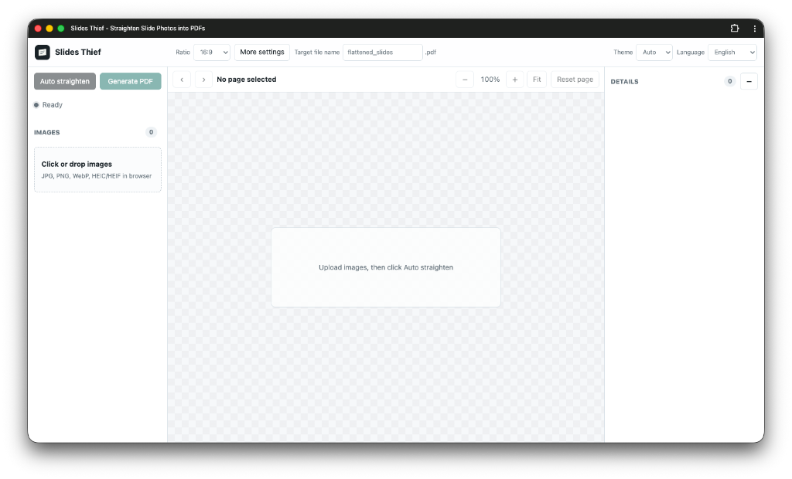

# Slides Thief - Turn Photographed Presentation Slides into Clean PDFs

Just take photos of the slides—they are yours now.

> Slides Thief is a browser-based tool that turns photographed presentation slides into perspective-corrected images and clean PDFs, with all processing performed locally.

- Canonical: https://www.zekun.blog/2026/07/13/slides-thief/
- Published: 2026-07-13
- Updated: 2026-07-22
- Author: Zekun Wang
- Tags: Computer Vision, Web Application, JavaScript, PDF Generation, Productivity Tool, Project, Local-First
- Series: Slides Thief Series, part 1 of 3

Taking photos of presentation slides during conferences, lectures, or meetups is convenient, but the resulting images are almost always skewed, unevenly framed, and difficult to organize. [Slides Thief](https://github.com/waittim/Slides-Thief) is a browser-based, local-first utility designed to detect slide boundaries, correct perspective distortion, and compile clean, standardized PDF documents directly on your device without backend uploads.

**Live Web App:** [slidesthief.com](https://slidesthief.com/)

Slides Thief supports presentation aspect ratios (16:9, 4:3) and standard paper presets (A4, A3, US Letter) with automatic white margin padding. When automated boundary detection encounters challenging room lighting or occlusions, users can adjust corner handles interactively before exporting. Please use it only for slides you are authorized to photograph and archive.

---

## Why Slides Thief?

Phone photos are convenient, but they are rarely clean. A typical slide photo may include:

* perspective distortion from sitting off-center
* background noise around the projected screen
* rotation or uneven framing
* reflections, shadows, or audience obstruction
* dozens of separate images that are hard to review later

Slides Thief helps convert those messy photos into a readable, organized PDF that is easier to archive, search, and share for personal study or documentation.

---

## Web App: Local Processing in Your Browser

For most users, the easiest way to use Slides Thief is the web app. It runs locally in your browser and requires no installation.

### Key Features

* **Local-first processing**
  Image conversion, perspective correction, and PDF generation happen directly in your browser. Your slide photos are not uploaded to a backend server.

* **Automatic perspective correction**
  Slides Thief detects the likely slide boundary and transforms the photo into a clean rectangular page.

* **Manual corner adjustment**
  When the automatic result is affected by reflections, complex backgrounds, or partial obstruction, you can drag the four corner handles to fine-tune the correction.

* **Flexible output ratios**
  Export to 16:9 or 4:3 for presentation-style pages, or to A4/A3 and US Letter in landscape or portrait. Paper presets center the corrected slide on the page and fill the margins with white.

* **Batch PDF export**
  Process multiple slide photos and export them as a single PDF document.

* **iPhone-friendly image support**
  In addition to JPG, PNG, and WebP, Slides Thief supports HEIC/HEIF images and converts them in the browser before processing.

* **Clean web interface**
  The app supports drag-and-drop, dark/light theme behavior, and a UI in nine languages: Simplified Chinese, Traditional Chinese, English, Spanish, French, German, Japanese, Korean, and Brazilian Portuguese.

---

## Web UI Preview

The following screenshot shows the main interface of the Slides Thief Web App:

<a href="https://slidesthief.com/"><picture><source srcset="/img/posts/2026-07-13-slides-thief/ui-dark.png" media="(prefers-color-scheme: dark)"></picture></a>

A typical workflow looks like this:

1. **Import images**
   Drag and drop your slide photos into the upload area.

2. **Run automatic correction**
   Click **Auto straighten** to detect slide boundaries and apply perspective correction.

3. **Review and adjust**
   Check each result. If automatic detection misses the real slide boundary, drag the four corner handles to correct it manually.

4. **Export PDF**
   Choose the target aspect ratio or paper preset, click **Generate PDF**, then **Download PDF** to save the final document.

---

## Advanced Settings

Open **More settings** in the export panel when you need finer control over the output:

* **Output width and height**
  Set the pixel dimensions of each corrected page. Height can be left automatic based on the selected ratio.

* **JPEG quality**
  Adjust compression quality for the flattened slide images inside the PDF.

* **Enhancement modes**
  Choose how the corrected slide should look before export:
  * *Original*: no extra processing
  * *Clean*: mild sharpening and contrast cleanup
  * *High contrast*: stronger contrast for low-light photos
  * *Black & white*: scan-style monochrome output

* **Fill color**
  Customize the background color around the corrected slide. Paper presets default to white margins.

You can also rename the PDF before download. All of these options are processed locally in the browser, just like the core correction workflow.

---

## Tips for Better Results

Automatic detection works best when the physical slide boundary is visible in the photo.

For better results:

* keep the full slide frame inside the photo
* avoid cutting off slide corners
* reduce reflections when possible
* take photos with enough contrast between the slide and the background
* run automatic correction first, then manually adjust outliers

Internal chart lines, audience members, strong reflections, or dark slide backgrounds may occasionally confuse the edge detector. In those cases, manual corner adjustment gives you full control over the final crop and perspective.

---

## Try It

You can try Slides Thief directly in your browser:

[Open the Web App](https://slidesthief.com/)

The source code is available on GitHub:

[View on GitHub](https://github.com/waittim/Slides-Thief)

If the tool helps your note-taking or slide-archiving workflow, consider starring the repository or opening an issue with feedback.

For the 2.0 detection architecture—multi-detector candidates, confidence, and batch geometry—see [Slides Thief 2.0: From Rectangle Heuristics to Evidence-Aware Review](/2026/08/01/slides-thief-2-detection/).

## Slides Thief Series

- Overview (this page)
- [Detection 2.0](https://www.zekun.blog/2026/08/01/slides-thief-2-detection/index.md)
- [Review Loop](https://www.zekun.blog/2026/10/15/slides-thief-review-loop/index.md)

## Related

- [Super-Fast In-Browser Face Mask Detection](https://www.zekun.blog/2020/11/27/mask-detection/index.md): WearMask: a super-fast in-browser face mask detector that runs locally with NCNN and WebAssembly.
- [WearMask - Face Mask Detection Project Details](https://www.zekun.blog/2020/12/01/mask-detection-report/index.md): Project details behind WearMask, a low-cost local face mask detection setup for small businesses and public spaces.
- [Characterizing browser-based medical imaging AI with serverless edge computing: towards addressing clinical data security constraints](https://www.zekun.blog/2023/04/10/paper-browser-based-medical-imaging-ai/index.md): Paper summary: characterizing browser-based medical imaging AI with serverless edge computing under clinical data constraints.

Older: [MemoryCustodian: Durable Project Memory for Coding Agents](https://www.zekun.blog/2026/07/01/memory-custodian/index.md)
Newer: [Why Project Memory Should Be Plain Text and Repo-Native](https://www.zekun.blog/2026/07/20/memory-custodian-tech-design/index.md)
